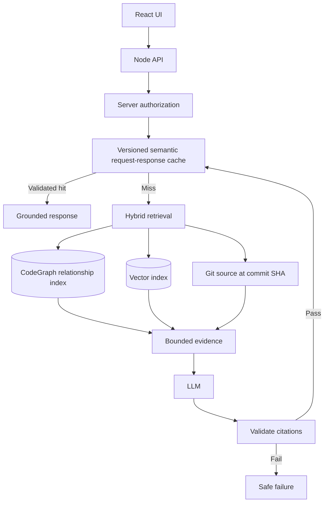
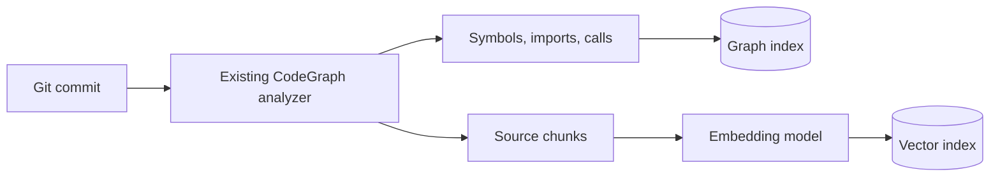
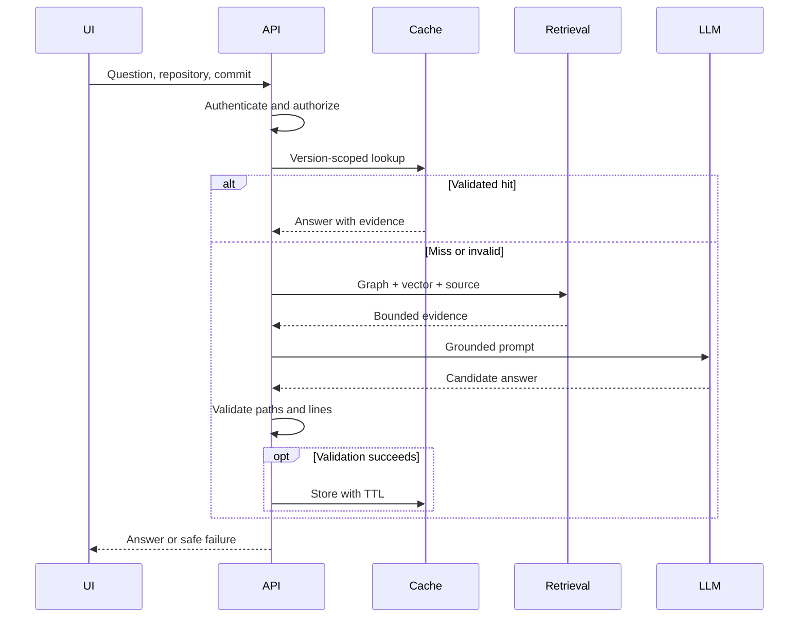

# Code Intelligence Architecture

**Status:** Proposed; implementation unverified.

## Indexing

## Source of truth

- Git commit: authoritative source.
- CodeGraph relationships: derived, rebuildable index.
- Vector embeddings: derived, rebuildable index.
- Semantic request-response cache: derived, versioned, bounded, invalidatable.
- Authentication and authorization: server authority, checked before cache access.

## Cache contract

Partition by tenant, repository, commit SHA, authorized scope, embedding version and answer-policy version. An exact cache match may reuse a validated answer. A semantically similar match requires independent equivalence and evidence validation; similarity alone is insufficient. TTL, capacity, eviction and invalidation are mandatory. Reject reuse when revision, access, evidence or policy changes.

## Request sequence

## Acceptance gates — UNVERIFIED

1. First query retrieves evidence and generates a validated answer.
2. Identical repeat uses cache without another LLM call.
3. Equivalent wording only reuses evidence-valid results.
4. Changed commit or revoked access rejects stale cache.
5. Unsupported citations fail safely.
6. Bounded storage, eviction and cache-outage fallback are tested.

## Scope and costs

One-day prototype target: one sample repository, basic graph relationships, vector search, semantic cache, grounded explanation and minimal React UI. Defer incremental indexing, distributed scaling and multi-repository administration. Runtime costs include embedding/index storage and LLM calls on cache misses. Maintenance centers on index versioning and invalidation. Database choice and dependency weight remain unverified. **Explicit approval required** before adding a database dependency or changing architecture.

The graph and vector databases represent *logical capabilities*, not necessarily separate products. Verify existing database functionality before choosing a new one.
