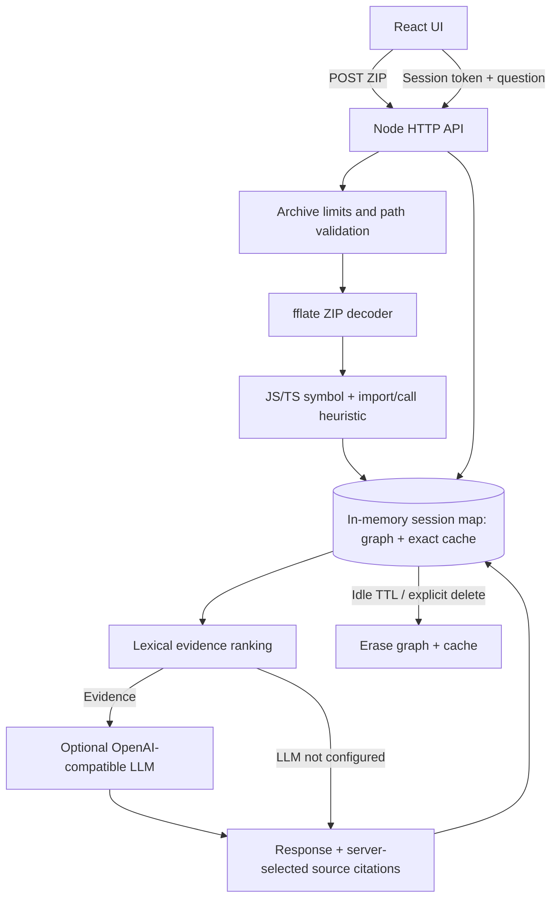
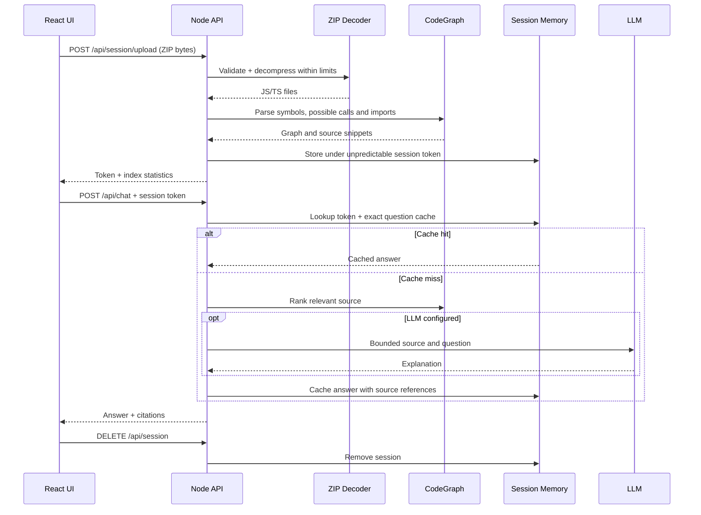
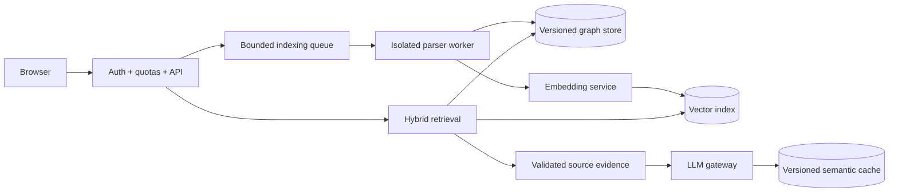
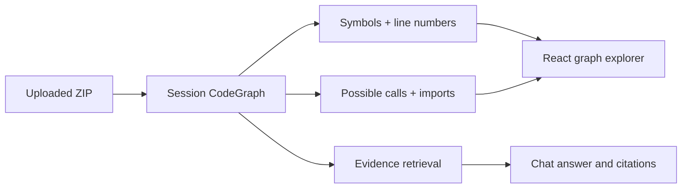

# Architecture — Code Documentation Assistant (Assignment)

**Implementation status:** Partial proof-of-concept. Architecture includes proposed production extensions explicitly separated from delivered code.

## 1. Goals and constraints

The assignment asks for a fullstack conversational assistant that ingests a codebase and answers questions about implementation, endpoints and dependencies. The implementation prioritizes a small end-to-end proof, not a SaaS product. Users upload a ZIP through React; the server creates an isolated, temporary in-memory CodeGraph and response cache. A new session must not inherit previous source, indexes, answers or conversation.

## 2. Runtime architecture (implemented)

The implementation uses an in-memory graph representation, not a graph database. Call edges are **possible-call heuristics**, not compiler-resolved relationships. No vector embeddings or semantic similarity caching are implemented.

## 3. Sequence: upload, question, cleanup

## 4. Ownership and lifecycle

| Item | Owner | Lifecycle |
|---|---|---|
| Uploaded ZIP bytes | Request handler | Released after parsing |
| Source snippets and symbols | Session graph | Session end, idle expiry or process restart |
| Possible-call/import edges | Session graph | Same as source |
| Request-response exact cache | Session | Same as source, max 50 entries |
| Session token | Browser memory | Browser reload loses access; idle timeout 30 min |
| LLM credentials | Backend environment | Never sent to browser |
| Vector index / graph database | Not implemented | Future design only |

Sessions are limited to ten simultaneous entries; an idle sweeper runs every minute and is unref'd. Each ZIP is limited to 5 MiB compressed, 15 MiB expanded, 200 entries, 150 KiB per entry. ZIP names with traversal or absolute paths are rejected. Files are not written to disk by the application. The archive library and the runtime must still be evaluated for CPU/decompression resource ceilings before accepting hostile uploads.

## 5. CodeGraph design and accuracy

For each accepted JS/TS file, store path, source lines and declarations. Derive symbol IDs as `path:line`. Derive imports from `from '...'` statements. Derive *possible-call* edges from same-file name matching; no AST type resolution, alias tracking, cross-module resolution or dynamic dispatch analysis. Retrieval scores symbol-name matches, matching source lines and paths. Return at most four excerpts, each with bounded line ranges. The source graph is the authority for citation paths and line numbers; the LLM is not.

Limitations: regular-expression parsing can mistake comments or strings for code, miss multiline declarations, misinterpret overloads and infer false call edges. The proof does not claim to reuse the CodeSight extension parser. A production implementation should reuse a framework-independent parser or Tree-sitter/TypeScript compiler API after a compatibility review.

## 6. Retrieval and LLM choices

**Implemented:** lexical graph-assisted retrieval + bounded excerpts + optional OpenAI-compatible chat completions; no framework or agent orchestrator. This reduces dependency count and makes the execution path explicit. The LLM is asked to explain only supplied evidence, with uncertainty when evidence is insufficient. Source references come from the index, but a generated answer is not independently checked for semantic correctness.

**Considered:** vector-only RAG (good conceptual discovery, weak explicit call relationships); graph-only traversal (strong explicit relationships, weak natural-language discovery); hybrid graph + vector retrieval (preferred future architecture, greater indexing and invalidation cost). No embedding model or vector DB is selected for the proof. Selection requires an evaluated retrieval dataset and measured latency/cost.

**Future cache:** exact match first, then optional semantic reuse only if repository revision, authorized scope, retrieval evidence and answer policy are identical or independently validated. Similarity alone must not authorize reuse. Current exact cache is session-local, not a semantic cache.

## 7. Trust and security

The prototype binds to loopback, accepts one ZIP upload per new session, and uses a high-entropy session token as a bearer capability. The token is kept only in React memory, not localStorage. The API limits request size and source indexing. It does **not** implement user authentication, malware scanning, hardened sandboxing, distributed rate limits, or tenant isolation. Treat it as a trusted local demo, not an internet-facing upload service. Archive filenames and source are untrusted data, not instructions. Prompt injection through source comments remains a risk; never give the LLM filesystem/network tools or secret-bearing context.

A new session is empty; there is no code persistence. Expiry is inactivity-based; a successful request extends the expiry. Deleting a session removes references from the session map, not a secure memory wipe of process pages. Crash dumps, external LLM providers and HTTP intermediaries can retain transmitted content; avoid claiming forensic erasure.

## 8. Quality and final proof

Only one final proof suite is required for this assignment. Execute `cd server && npm install && npm test` after adding the test script or `node --test index.test.mjs`; test ZIP ingestion, graph symbols, retrieval, cache miss/hit, malicious paths and unsupported content. Also run `cd web && npm install && npm run build` and manually upload a sample ZIP, ask two questions, verify references and end the session. **Do not claim PASS without execution.**

Observable demo indicators: files/symbols/relationships indexed, retrieval-only vs LLM mode, exact cache hit/miss, controlled error messages. No production telemetry stack is installed.

## 9. Production architecture (not implemented)

For AWS, GCP or Azure: object storage with short retention for uploads, sandboxed background workers, queue, managed API runtime, tenant-aware indexes, managed secrets, request quotas, distributed TTL cache, traces and audit logs. Explicit deletion must propagate to blobs, indexes, caches and job artifacts. Keep database writes and network inference outside a single transaction. Use idempotent indexing keyed by repository version and bounded retries. Encrypt at rest and in transit. This adds infrastructure cost, maintenance and lock-in, so it is outside the assignment.

## 10. Engineering tradeoffs

- **Reuse before create:** Node HTTP and React; fflate for ZIP rather than writing a decoder.
- **Single source of truth:** source attached to one session; derived graph and cache owned by that session.
- **Bounded resources:** entry count, archive sizes, cache count, TTL, sessions and LLM timeout.
- **Server authority:** index and citations generated server-side; UI only displays results.
- **Deliberate omissions:** no persistent graph/vector DB, orchestration framework, authentication or CI setup for the prototype.
- **With more time:** real AST-based CodeGraph, multi-language parsing, hybrid retrieval, semantic equivalence evaluation, stronger citations, asynchronous indexing, sandboxing, session cleanup tests and a browser demo recording.
- **AI-assisted work:** AI-generated scaffolding and architecture must be reviewed against source behavior; the final proof is an execution gate, not a claim of automatic correctness.

## 11. Verification automation and graph explorer (current increment)

The assignment's single final proof is automated in `.github/workflows/final-proof.yml`. It installs the existing dependencies, runs `node --check` for backend syntax, executes the backend proof tests, and builds the React UI. These checks are not equivalent to a browser acceptance test or a live LLM proof. GitHub Actions status must be inspected before reporting PASS.

The session-only `GET /api/graph` endpoint returns bounded file names, symbol records and relationship records to the UI (up to 200 symbols and 300 edges). React renders a compact explorer with symbol locations and relationship descriptions. This is a text-based graph inspection panel, not an interactive graph visualization or a compiler-resolved CodeGraph. The session token is required for the endpoint. Data is not persisted and is deleted with the session.

**Verification contract:** The final proof must demonstrate ZIP upload, symbol and relationship extraction, source-grounded chat, repeat-request cache hit, explicit session deletion and rejection of the old session. The CI job tests the HTTP lifecycle without requiring an external model. A separate manual demo must prove that an actual LLM explanation works if an LLM is configured.

**Tradeoff:** This remains heuristic extraction. Accurate cross-file call resolution, AST traversal, graph traversal ranking, embeddings and semantic cache are outside this increment. Reusing an existing CodeSight parser remains a future evaluation, not a claim of implemented integration.

## 12. Final UAT hardening

The final-readiness increment rejects invalid ZIP signatures before decompression, checks expanded source-file size after decoding, ignores unsupported ZIP entries during indexing, rejects cross-origin browser requests and verifies session isolation with an HTTP proof. These are local-demo safeguards, not a substitute for sandboxing untrusted archives.

Browser origin checking does not authenticate non-browser callers; session tokens remain bearer capabilities. The ZIP decoder still performs synchronous work on the Node event loop and should not be exposed as a public upload endpoint. No persistent code memory is introduced.

The final proof suite additionally covers invalid ZIP signatures, forbidden origins and two simultaneous sessions with distinct CodeGraphs. Manual UAT remains necessary; see `docs/UAT-CHECKLIST.md`. If CI is green, the remaining user acceptance step is to verify the actual React flow and optional LLM response.
